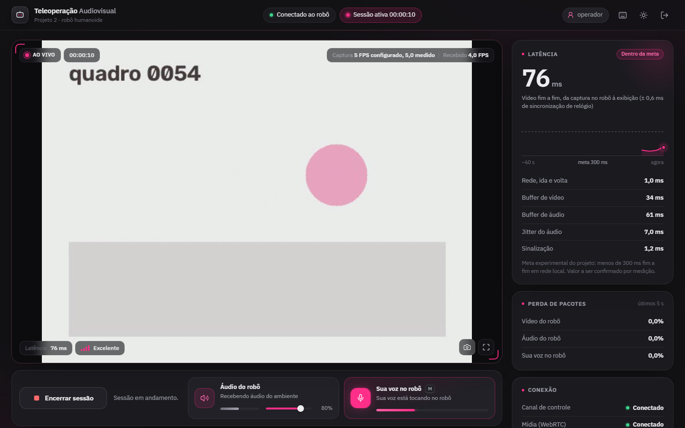

# Teleoperação Audiovisual — Projeto 2

Comunicação audiovisual bidirecional entre um robô humanoide e um operador em outra sala.
O computador do robô captura a webcam a **5 FPS** e o microfone continuamente, e transmite
por **WebRTC** (VP8/H.264 + Opus) ao navegador do operador. A voz do operador volta pelo
mesmo canal e é reproduzida no alto-falante do robô. **FastAPI + WebSocket** cuidam de
autenticação, sinalização e mensagens de controle — nunca de quadros de vídeo.

## Requisitos atendidos

| Requisito | Onde está |
|---|---|
| RF01 Captura a 5 FPS | `teleop/capture/video.py` (thread dedicada, programação por prazo, quadro mais recente) |
| RF02 Áudio do robô → operador | `teleop/capture/audio.py` + `MicrophoneTrack` em `teleop/transport/tracks.py` |
| RF03 Exibição/reprodução no operador | `web/static/js/rtc.js`, `app.js` (vídeo, áudio, volume e silenciar) |
| RF04 Voz do operador → alto-falante do robô | `web/static/js/audio.js` (microfone) + `teleop/playback/speaker.py` |
| RF05 Estado da conexão e latência | `web/static/js/metrics.js` + `robot.stats` do robô |
| RF06 Iniciar/encerrar sessão | `teleop/session.py` (abre e **libera** webcam, microfone e alto-falante) |
| Autenticação | `teleop/auth.py` (PBKDF2, token HMAC em cookie HttpOnly, limite de tentativas) |
| Falhas e reconexão | Sinalização com reconexão automática; renegociação WebRTC; sessão retomável por 20 s |
| Separação captura/transmissão/reprodução | Threads de captura ↔ buffers ↔ trilhas aiortc ↔ thread do alto-falante |
| Sem acúmulo de atraso | `LatestSlot` (só o quadro mais recente), fila de áudio limitada, buffer de reprodução limitado |

## Arquitetura

```
 COMPUTADOR DO ROBÔ (python -m teleop)                         COMPUTADOR DO OPERADOR (navegador)
 ┌───────────────────────────────────────────────┐            ┌──────────────────────────────────┐
 │ thread webcam ──► LatestSlot ──► CameraTrack ─┼── VP8 ────►│ <video>  + requestVideoFrameCb   │
 │   (OpenCV, 5 FPS, só o quadro mais recente)   │            │                                  │
 │ thread microfone ─► fila 160 ms ─► MicTrack ──┼── Opus ───►│ <audio>  + medidor de nível      │
 │                                               │   WebRTC   │                                  │
 │ thread alto-falante ◄─ buffer 40–160 ms ◄─────┼◄── Opus ───│ getUserMedia (eco cancelado)     │
 │                                               │            │                                  │
 │ FastAPI: /api/login · /ws (sinalização) ◄─────┼─ WebSocket ┤ ping/pong, sessão, estados       │
 └───────────────────────────────────────────────┘            └──────────────────────────────────┘
```

O próprio computador do robô serve a interface web. **O operador não instala nada**: basta
um navegador (Chrome ou Edge recomendados) na mesma rede.

### Fluxo da sessão

1. O operador faz login; o navegador abre o WebSocket autenticado pelo cookie.
2. "Iniciar sessão": o robô abre webcam, microfone e alto-falante; o navegador envia uma
   oferta WebRTC (vídeo só recepção, áudio nos dois sentidos) e recebe a resposta.
3. "Falar ao robô" (botão ou tecla **M**): pede permissão do microfone e injeta a trilha na
   conexão já existente (`replaceTrack`, sem renegociar).
4. "Encerrar sessão" (com confirmação): fecha a conexão e libera todos os dispositivos.

### Falhas e reconexão

| Situação | Comportamento |
|---|---|
| WebSocket cai | Reconexão automática com recuo exponencial; ao voltar, `session.resume` retoma a mesma sessão |
| Mídia cai (ICE `failed`/`disconnected` > 3,5 s, ou o robô detecta a queda) | Nova oferta WebRTC; os dispositivos do robô continuam abertos; até 6 tentativas, depois "Conexão perdida" com "Tentar novamente" |
| Página recarregada / operador some | A sessão fica reservada por `TELEOP_SESSION_GRACE_S` (20 s) e pode ser **assumida**; depois disso é encerrada e os dispositivos são liberados |
| Webcam/microfone/alto-falante ausente ou desconectado | Estado "Indisponível" na interface e nova tentativa automática a cada 2 s |
| Outra janela tenta operar | Recusado: "A sessão já está ativa em outra janela" |

## Instalação

Requer Python 3.10+.

```bash
python -m venv .venv && source .venv/bin/activate   # Windows: .venv\Scripts\activate
pip install -r requirements.txt
# Linux: biblioteca de áudio usada pelo sounddevice
sudo apt install libportaudio2
```

### Configuração (computador do robô)

```bash
cp .env.example .env
python -m teleop.hash_password            # copie a linha gerada para o .env
python -c "import secrets; print(secrets.token_urlsafe(48))"   # TELEOP_SECRET_KEY
```

No `.env`, mantenha o hash entre aspas simples (ele contém `$`). Credenciais e chave
**nunca** ficam no código e não aparecem nos logs.

Para listar dispositivos de áudio: `python -m sounddevice`. A webcam é escolhida por
`TELEOP_CAMERA` (índice ou caminho, ex.: `/dev/video0`).

### HTTPS (necessário para o microfone do operador)

Navegadores só liberam o microfone em HTTPS ou em `localhost`. Como o operador acessa o robô
pelo IP da rede, gere um certificado:

```bash
scripts/gerar_certificado.sh 192.168.0.42      # IP do computador do robô
```

No Windows (ou sem `openssl`), use a versão em Python; sem IP, ela detecta o da rede local:

```bash
python scripts/gerar_certificado.py             # ou: python scripts/gerar_certificado.py 192.168.0.42
```

O `.env.example` já aponta para `certs/robo.crt` e `certs/robo.key`. No primeiro acesso o
navegador mostrará um aviso de certificado autoassinado; aceite-o (ou instale `certs/robo.crt`
como confiável no computador do operador).

## Execução

**Computador do robô:**

```bash
python -m teleop
```

**Computador do operador:** abra `https://<IP-do-robô>:8443`, entre com as credenciais e
clique em **Iniciar sessão**. Use fones de ouvido: o robô não tem cancelamento de eco, então
o operador ouviria a própria voz de volta pelo microfone do robô. (O cancelamento de eco do
navegador impede realimentação no lado do operador.)

Os dois papéis podem rodar na mesma máquina para ensaio: `http://localhost:8443` já é
considerado seguro pelo navegador (deixe `TELEOP_SSL_*` vazios).

Para ensaiar sem webcam, `TELEOP_CAMERA` aceita o caminho de um arquivo de vídeo, lido pela
mesma rotina de captura a 5 FPS e reiniciado ao terminar.

## Interface do operador



- **Visual grafite com detalhes em rosa**: a base é cinza; o rosa forte marca apenas o que
  merece atenção (indicador ao vivo, microfone aberto, foco do teclado, gráfico de latência).
  Há também um **tema claro**, escolhido no botão do cabeçalho e lembrado pelo navegador.
- **HUD sobre o vídeo**: cronômetro da sessão, FPS de captura e de recepção, latência fim a
  fim e qualidade do link (Excelente, Boa, Instável ou Ruim, calculada a partir da latência e
  da perda de pacotes medidas).
- **Gráfico dos últimos 60 s** de latência fim a fim, com a linha da meta de 300 ms e leitura
  ponto a ponto ao passar o mouse. Segundos sem medição aparecem como lacunas.
- **Tela cheia** e **captura do quadro atual** em PNG, na resolução original do vídeo.
- **Avisos flutuantes**: os informativos somem sozinhos; erros e alertas ficam até serem dispensados.
- **Login** com opção de mostrar a senha e aviso de Caps Lock.

| Atalho | Ação |
|---|---|
| `M` | Ligar/desligar o microfone do operador |
| `F` | Vídeo em tela cheia |
| `P` | Salvar o quadro atual como imagem |
| `T` | Alternar tema claro/escuro |
| `?` | Mostrar a lista de atalhos |

## Métricas exibidas (todas medidas, nenhuma simulada)

| Métrica | Origem |
|---|---|
| **Vídeo fim a fim** | Do instante da captura no robô até a exibição. O robô informa a origem do timestamp RTP e o relógio de captura; `requestVideoFrameCallback` fornece o timestamp RTP de cada quadro exibido. A diferença de relógio entre as máquinas vem do ping/pong (incerteza ± ½ RTT, exibida). Chrome/Edge; em outros navegadores aparece "Indisponível". |
| Rede, ida e volta | `currentRoundTripTime` do par ICE selecionado (WebRTC) |
| Buffer de vídeo/áudio | `jitterBufferDelay / jitterBufferEmittedCount` (últimos 1 s) |
| Jitter do áudio | `inbound-rtp.jitter` |
| Sinalização | Ida e volta do ping no WebSocket |
| Perda de pacotes | Vídeo e áudio do robô: `inbound-rtp` do navegador (janela de 5 s). Sua voz no robô: estatísticas de recepção do aiortc no robô |
| FPS | "Captura": configurado e medido na thread de captura do robô. "Recebido": quadros decodificados por segundo no navegador |

A meta de **< 300 ms** aparece como objetivo experimental, e não como garantia.

> Detalhe técnico: o aiortc não expõe a origem aleatória que soma ao timestamp RTP. Ela é
> deduzida lendo o último timestamp enviado pelo `RTCRtpSender` (atributo interno usado nos
> Sender Reports). Validado no aiortc 1.15; se uma versão futura mudar esse atributo, só a
> métrica fim a fim fica "Aguardando medição" — o restante do sistema não depende dela.

## Testes

```bash
pip install -r requirements-dev.txt
python -m playwright install chromium     # opcional, para os testes de navegador
python -m pytest
```

- `tests/test_units.py` — autenticação, configuração, buffers, captura a 5 FPS, reabertura de
  dispositivo, continuidade do áudio, limite de atraso da reprodução.
- `tests/test_api.py` — login, limite de tentativas, logout/revogação, cabeçalhos de segurança,
  WebSocket sem autenticação (4401) e de origem estranha (4403), validação de mensagens.
- `tests/test_webrtc_session.py` — negociação WebRTC real (aiortc ↔ aiortc): vídeo a ~5 FPS,
  áudio nos dois sentidos, latência fim a fim pelo mapa de relógio, sessão em uso, retomada,
  expiração da sessão órfã, renegociação mantendo dispositivos, liberação de recursos.
- `tests/test_e2e_browser.py` — Chromium real contra o backend real: login, sessão, vídeo,
  áudio, voz do operador chegando ao alto-falante, queda do WebSocket e da mídia com
  recuperação automática, recarga da página e assumir sessão, encerramento, layout
  responsivo, política de segurança (CSP) ativa. Capturas em `tests/artifacts/`.

Os testes usam dublês **apenas** para o hardware (webcam sintética, tom senoidal no lugar do
microfone, gravador no lugar do alto-falante). O procedimento de validação com hardware
real está em [`VALIDACAO.md`](VALIDACAO.md).

## Estrutura

```
teleop/
  config.py            variáveis de ambiente (.env)
  auth.py              senha PBKDF2, token assinado, limite de tentativas
  capture/video.py     RF01 — webcam (OpenCV) em thread, 5 FPS
  capture/audio.py     RF02 — microfone do robô (PortAudio)
  capture/buffers.py   quadro mais recente / fila de áudio limitada
  playback/speaker.py  RF04 — alto-falante do robô com buffer de jitter limitado
  transport/tracks.py  trilhas WebRTC + mapa de relógio do vídeo
  transport/peer.py    RTCPeerConnection, codecs, estatísticas
  session.py           RF06 — ciclo de vida, retomada, supervisor
  signaling.py         WebSocket de sinalização (mensagens validadas)
  app.py, __main__.py  FastAPI, cabeçalhos de segurança, inicialização
web/                   interface do operador (HTML, CSS, JS sem dependências externas)
tests/                 testes automatizados
```
